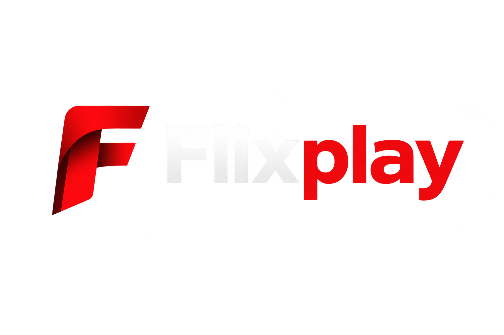

# 🍿 FLIXPLAY

**Your Personal Streaming Assistant for Movies & TV Shows**

FLIXPLAY is a powerful, open-source streaming platform that brings movies, TV series, and anime to your fingertips. Built with Vanilla JS, Firebase, and the TMDB API.

 

  

 

## 🚀 What's New in v1.0.1

| Area | What changed |
| :--- | :--- |
| **Global Sync** | User accounts and configurations are now securely synced using Firebase Realtime Database. Log in on web or app seamlessly. |
| **Admin Studio** | A brand new, fully functional Admin Dashboard to manage your catalog, auto-import from TMDB, and configure streaming servers. |
| **Multi-Server** | Added support for multiple streaming servers (Vidrift, VidBolt, FilmU, 2Embed, VidSrc). Automatically falls back if one fails. |
| **Mobile App** | Packaged as a standalone Android APK for a native-like, full-screen viewing experience without browser clutter. |

## 📜 Still the same idea

No ads, no subscriptions. Just your favorite movies and TV shows, organized in a clean, Netflix-style interface. FLIXPLAY acts as a unified hub that pulls metadata from TMDB and connects to various streaming sources, giving you full control over your personal library.

---

## 🎯 Features

*   **Dynamic Catalog:** Browse trending, popular, and top-rated movies, TV shows, and anime directly from TMDB.
*   **Powerful Search:** Instantly search across millions of titles globally with integrated IMDb and TMDB data.
*   **Admin Studio:** A secure dashboard to auto-import 100 titles at a click, edit metadata, and manage stream URLs.
*   **Smart Fallback Servers:** The player automatically attempts to fetch IMDb or AniList IDs and switches servers seamlessly if a link is broken.
*   **Personal Watchlist:** Save movies and shows to "My List" for quick access later. 
*   **Continue Watching:** Keep track of what you're currently watching with a dedicated row on the homepage.

---

## 🛠️ Stack

| Layer | Choice |
| :--- | :--- |
| **Frontend** | HTML5, Vanilla JavaScript |
| **Styling** | Tailwind CSS (Utility-first framework) |
| **Database** | Firebase Realtime Database |
| **Authentication** | Firebase Auth (Admin), Custom DB Sync (Users) |
| **APIs** | TMDB (Metadata), AniList (Anime IDs) |
| **Hosting** | Netlify / GitHub Pages (Web), Custom WebView (App) |

---

## 📲 Installation

Get FLIXPLAY running on your device in seconds.

### 🤖 Android (APK)

1.  Go to the **Releases** section of this repository.
2.  Download the latest `Flixplay.apk` file to your phone.
3.  Open the downloaded file. If prompted, allow your browser or file manager to **"Install unknown apps"**.
4.  Tap **Install** and enjoy!

*(Note: Because this is a custom APK, Google Play Protect may show a warning. Tap "More details" and "Install anyway" to proceed.)*

### 🌐 Web Version

You don't need to install anything to use the web version. Simply visit the live link below:

👉 **[Launch Flixplay Web App](https://flix-play.netlify.app/)**

---

## ⚠️ Important Notice: Data & Servers

FLIXPLAY **does not host any files** on its own servers. All metadata (posters, descriptions, ratings) is provided by the **TMDB API**. 

The actual video playback relies on third-party embed servers configured in the Admin Panel. FLIXPLAY simply acts as a bridge. If a specific server is down or missing an ID for a title, please try selecting a different server from the list below the video player.

---

## 🤝 Contributing

Contributions are what make the open-source community such an amazing place to learn, inspire, and create. Any contributions you make are **greatly appreciated**.

1. Fork the Project
2. Create your Feature Branch (`git checkout -b feature/AmazingFeature`)
3. Commit your Changes (`git commit -m 'Add some AmazingFeature'`)
4. Push to the Branch (`git push origin feature/AmazingFeature`)
5. Open a Pull Request

---

## 👤 Author

**Your Name**
- GitHub: [@rpgamerzn](https://github.com/rpgamerzn)

---

## 📄 License

Distributed under the **MIT License**. See `LICENSE` for more information.

---

## ⚖️ Legal Disclaimer

FLIXPLAY is an open-source project provided for educational and personal use only. 

We do not host, upload, or manage any video content. All content is scraped, embedded, or linked from third-party services that are publicly available on the internet. We are not responsible for the accuracy, compliance, copyright, legality, or decency of the material contained in these external sources.

If you are a copyright owner and believe your content is being accessed improperly, please contact the respective third-party hosting providers directly, as we have no control over their servers.
